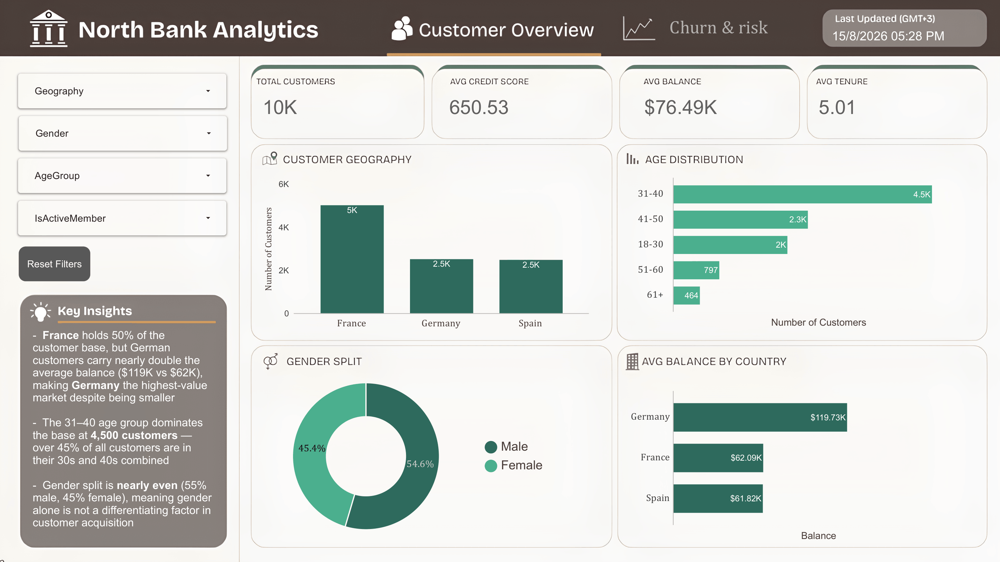
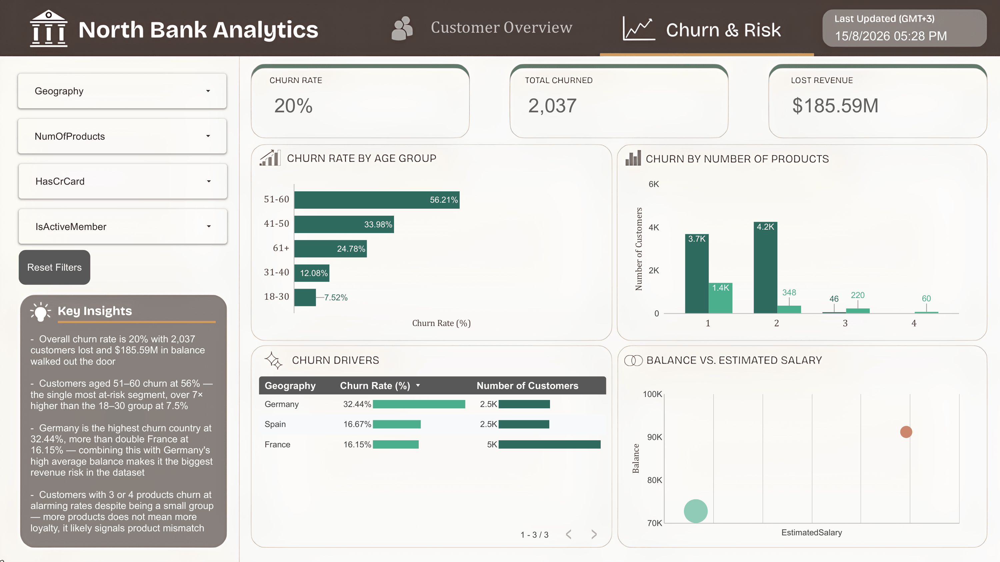

# 🏦 North Bank Analytics — Customer Churn Dashboard

An end-to-end analytics project: cleaning a messy two-sheet banking workbook with **Python (pandas)** and turning it into an interactive, two-page **Looker Studio** dashboard that shows who the bank's customers are, who is leaving, and how much balance walks out with them.

> 🔗 **Live dashboard:** [Open in Looker Studio](https://datastudio.google.com/reporting/e231e675-b99a-49a8-9e9f-e970397ebc00)
> 📊 **Clean dataset (Google Sheets):** [View sheet](https://docs.google.com/spreadsheets/d/1VAncPoiiy0aRdLtAl9aLQV7Yl4KjSOBvnar_hlXIgGE/edit?usp=sharing)

---

## 📸 Dashboard Preview

### Page 1 — Customer Overview

<!-- TODO: replace with your screenshot. Save it as images/01_customer_overview.png -->

### Page 2 — Churn & Risk

<!-- TODO: replace with your screenshot. Save it as images/02_churn_and_risk.png -->

---

## 🎯 Business Problem

North Bank is losing **1 in 5 customers**. Leadership needs to know:

1. Who are our customers (country, age, gender, balance)?
2. Which segments churn the most?
3. How much balance is leaving with them, and where should retention effort go first?

---

## 🔑 Headline Numbers

| Metric | Value |
|---|---|
| Total customers | **10,000** |
| Average credit score | **650.53** |
| Average balance | **76.49K** |
| Average tenure | **5.01 years** |
| Churn rate | **20%** (20.37%) |
| Customers churned | **2,037** |
| Balance lost to churn | **185.59M** |

---

## 💡 Key Insights

### Customer Overview
- **France is the largest market** (50% of customers), but **Germany is the highest-value market**: average balance of ~119.7K vs ~62K in France and Spain.
- The **31–40 age group is the biggest segment** (~4,500 customers, about 45% of the base). Adding 41–50 brings the 30s and 40s to roughly two-thirds of all customers.
- **Gender is nearly balanced** (54.6% male / 45.4% female), so gender alone doesn't explain acquisition.

### Churn & Risk
- **Customers aged 51–60 churn at 56.2%**, more than 7× the rate of 18–30 year-olds (7.5%).
- **Germany churns at 32.4%**, double France (16.2%) and Spain (16.7%). Combined with Germany's high balances, it's the **biggest revenue risk**.
- **More products ≠ more loyalty.** Customers with 1 product churn at ~28%, with 2 products at ~8%, but with **3 products at ~83% and 4 products at 100%**. This is a small group, but it points to a product-fit or mis-selling problem.

### Recommendations
1. Launch a targeted retention programme for **German customers** and the **51–60 segment**.
2. Review the **3–4 product bundles**: find out why these customers leave.
3. Protect the 2-product customers; they are the most loyal group and a model for cross-sell.

---

## 🧹 Data Cleaning (Python)

The raw file `Bank_Churn_Messy.xlsx` has two sheets (`Customer_Info`, `Account_Info`) with deliberately realistic problems. All fixes live in [`scripts/clean_bank_churn.py`](scripts/clean_bank_churn.py).

| Problem found | Fix |
|---|---|
| Duplicate rows (1 in `Customer_Info`, 2 in `Account_Info`) | De-duplicated on `CustomerId` |
| `Geography` spelled 5 ways: `France`, `French`, `FRA`, `Germany`, `Spain` | Mapped to 3 clean values |
| Money stored as text with currency symbol (`€101348.88`) | Stripped symbol, converted to numeric |
| Placeholder salary `-€999999` (3 rows) | Treated as missing → filled with median |
| Missing `Age` (3 rows) and `Surname` (3 rows) | Age → median, Surname → `"Unknown"` |
| `HasCrCard` / `IsActiveMember` stored as `Yes`/`No` | Converted to `1`/`0` |
| `Tenure` duplicated across both sheets | Kept one copy |
| Two sheets | Merged into one table on `CustomerId` (validated 1:1) |
| No age buckets | Added `AgeGroup` (18-30, 31-40, 41-50, 51-60, 61+) |
| No audit trail | Added `HadMissingData` flag for repaired rows |

**Result:** 10,001 / 10,002 raw rows → **10,000 clean rows × 15 columns**, no nulls, unique `CustomerId`.

The cleaned output reproduces the dashboard figures exactly (10,000 customers, 2,037 churned, 185.59M lost balance).

---

## 📐 Dashboard Design

Built in **Looker Studio**, connected to the cleaned Google Sheet.

**Page 1 — Customer Overview**
- KPI cards: Total Customers, Avg Credit Score, Avg Balance, Avg Tenure
- Charts: Customer Geography, Age Distribution, Gender Split, Avg Balance by Country
- Filters: Geography, Gender, AgeGroup, IsActiveMember

**Page 2 — Churn & Risk**
- KPI cards: Churn Rate, Total Churned, Lost Revenue
- Charts: Churn Rate by Age Group, Churn by Number of Products, Churn Drivers by Geography, Balance vs. Estimated Salary
- Filters: Geography, NumOfProducts, HasCrCard, IsActiveMember

**Metric definitions**
- `Churn Rate` = average of `Exited` (1 = left the bank)
- `Total Churned` = sum of `Exited`
- `Lost Revenue` = sum of `Balance` where `Exited = 1`

---

## 🗂️ Repository Structure

```
north-bank-churn-analytics/
│
├── README.md
├── requirements.txt
├── .gitignore
│
├── data/
│   ├── raw/
│   │   └── Bank_Churn_Messy.xlsx        # original messy workbook (2 sheets)
│   └── processed/
│       └── Bank_Churn_Clean.csv         # output of the cleaning script
│
├── scripts/
│   └── clean_bank_churn.py              # Python cleaning pipeline
│
├── dashboard/
│   └── North_Bank_Churn_Analytics.pdf   # exported Looker Studio report
│
└── images/
    ├── 01_customer_overview.png         # screenshot (add yours)
    └── 02_churn_and_risk.png            # screenshot (add yours)
```

---

## ▶️ How to Reproduce

```bash
# 1. Clone
git clone https://github.com/YOUR_USERNAME/North-Bank-Churn-Analysis.git
cd North-Bank-Churn-Analysis

# 2. Install dependencies
pip install -r requirements.txt

# 3. Run the cleaning script
python scripts/clean_bank_churn.py
```

Output: `data/processed/Bank_Churn_Clean.csv`. Upload it to Google Sheets and connect it to Looker Studio to rebuild the dashboard.

---

## 🛠️ Tools

| Tool | Purpose |
|---|---|
| Python (pandas, numpy, openpyxl) | Data cleaning and validation |
| Google Sheets | Data source for the dashboard |
| Looker Studio | Interactive dashboard |

---

## 📚 Data Source

Based on the [Bank Customer Churn dataset](https://mavenanalytics.io/data-playground/bank-customer-churn) from Maven Analytics (10,000 customers across France, Germany, and Spain). The messy two-sheet version was used here to practise a realistic cleaning workflow.

---

## 👤 Author

**Marvy** — Data Analyst & Full-Stack Developer
🔗 [LinkedIn](https://www.linkedin.com/in/marvy-ayman/) · 💻 [GitHub](https://github.com/MarvyAyman) · 📧 marvyayman10@gmail.com
